# Mobile Shop POS — User Guide

This guide is for the people who run the shop: the owner, the cashiers and the technician.
It follows the order of a working day. Pictures are from version 1.0.1.

Contents

1. [Install and first run](#1-install-and-first-run)
2. [Signing in and who can do what](#2-signing-in-and-who-can-do-what)
3. [Counter: selling](#3-counter-selling)
4. [Buy: stock coming in](#4-buy-stock-coming-in)
5. [Stock](#5-stock)
6. [Repairs](#6-repairs)
7. [Khata: customers and suppliers](#7-khata-customers-and-suppliers)
8. [Cash: expenses and closing the day](#8-cash-expenses-and-closing-the-day)
9. [Staff and salaries](#9-staff-and-salaries)
10. [Reports](#10-reports)
11. [Settings](#11-settings)
12. [Your data and backups](#12-your-data-and-backups)
13. [A day in the shop, step by step](#13-a-day-in-the-shop-step-by-step)
14. [When something goes wrong](#14-when-something-goes-wrong)

---

## 1. Install and first run

1. Download `MobileShopPOS-<version>-setup.exe` from the
   [Releases](https://github.com/zawibuttar/mobile-shop-releases/releases/latest) page and run
   it. Windows may show a blue "Windows protected your PC" box the first time: click
   **More info**, then **Run anyway**. (Mac: open the `.dmg` and drag the app to Applications.)
2. The app opens on the setup wizard. Four short steps:

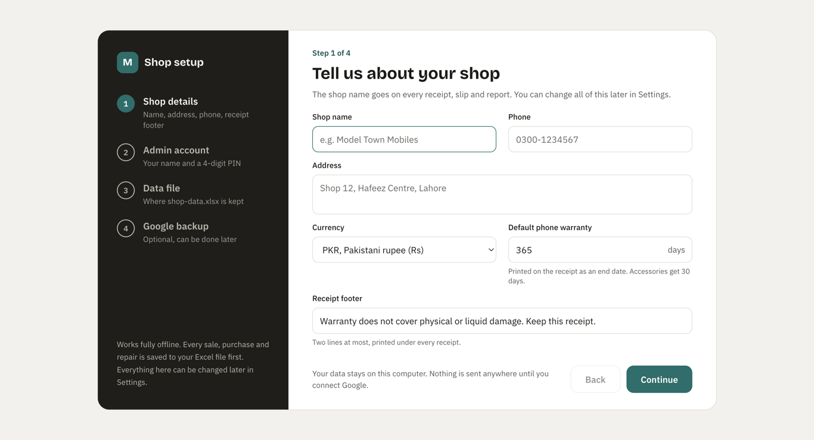

- **Shop details** — the shop name, phone and address go on every receipt and slip. Pick the
  currency and the default phone warranty (365 days unless you change it). The receipt footer
  is the line printed under every receipt.
- **Admin account** — your name and a 4-digit PIN. This is the owner login; keep the PIN to
  yourself.
- **Data file** — where the Excel workbook `shop-data.xlsx` is kept. The default is fine; a
  folder that is already backed up (OneDrive, Google Drive, a second disk) is better. You can
  move it later from Settings.
- **Google backup** — optional, can be done later.

Everything typed here can be changed later in **Settings**.

## 2. Signing in and who can do what

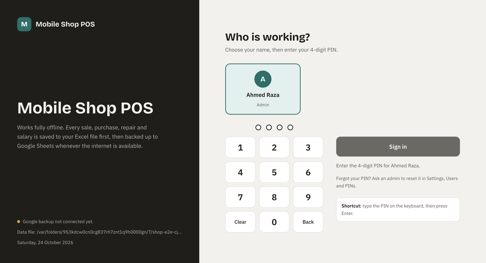

Tap your name, type your PIN. Five wrong PINs lock that user for a few minutes. The app also
returns to this screen on its own after the inactivity time set in Settings › Users.

There are three roles. Add cashiers and technicians in **Settings › Users and PINs**.

| Role | Sees | Can |
|---|---|---|
| **Admin** (owner) | Everything | Everything, including cost prices, profit, salaries, settings, write-offs |
| **Cashier** | Counter, Buy, Stock, Repairs, Khata, Cash | Sell, buy, take and give money, open and deliver repairs, close the day. Cannot see cost prices, profit or salaries |
| **Technician** | Repairs, Stock | Move repair jobs along and add parts. Cannot take money |

Some actions ask for the **admin PIN** even when a cashier is signed in: a discount above the
limit, selling a phone below cost, a sale that takes a customer over their khata limit, a return,
editing or deleting an expense, reopening a closed day, writing off a phone. The admin types
their PIN in the small box that appears; nothing else changes.

## 3. Counter: selling

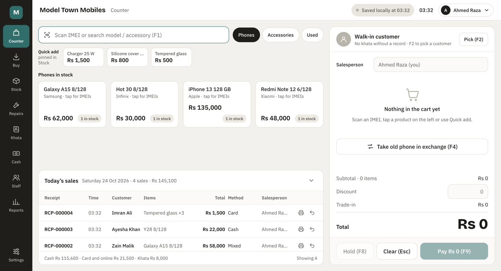

The search box takes a **scanned IMEI** (the barcode on the box: 15 digits and the scanner
presses Enter for you) or a model or accessory name. Scanning an IMEI that is in stock puts
that phone straight into the cart. The chips filter to Phones, Accessories or Used; tapping a
phone model lists its IMEIs with condition and price.

**Quick add** is the row of pinned accessories above the results: one tap adds one, a second
tap makes it two. Pin accessories from **Stock › Accessories & parts › Edit**.

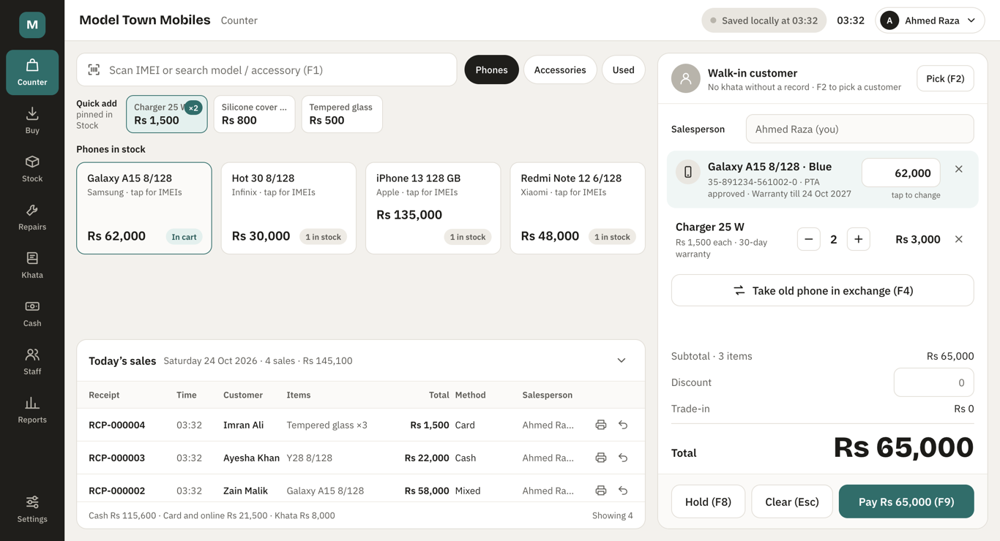

The cart on the right:

- **Customer** — Pick (F2) a customer with a record, or leave it as a walk-in. A customer with a
  record can leave part of the bill on khata; a walk-in must pay in full.
- **Salesperson** — defaults to you; commission follows the salesperson.
- **Lines** — change an accessory quantity with the stepper; tap a phone's price to change it.
  Selling a phone below its cost asks for the admin PIN.
- **Discount** — an amount off the cart. Above the cashier limit (Settings › Sales rules) it
  asks for the admin PIN.
- **Take old phone in exchange (F4)** — see below.
- **Hold (F8)** parks this cart (customer and lines) so you can serve someone else; the amber
  pill in the cart header brings it back. Held carts are forgotten at sign-out.

### Taking payment

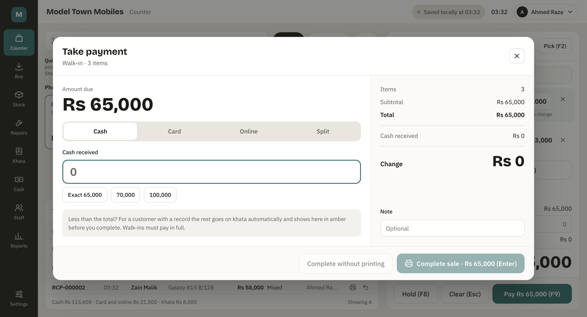

**Pay (F9)** opens the payment box. Cash: type what the customer handed over; the change shows
in large type. Card and Online: the amount and the reference number. **Split** takes more than
one line, for example cash 30,000 + online 24,000:

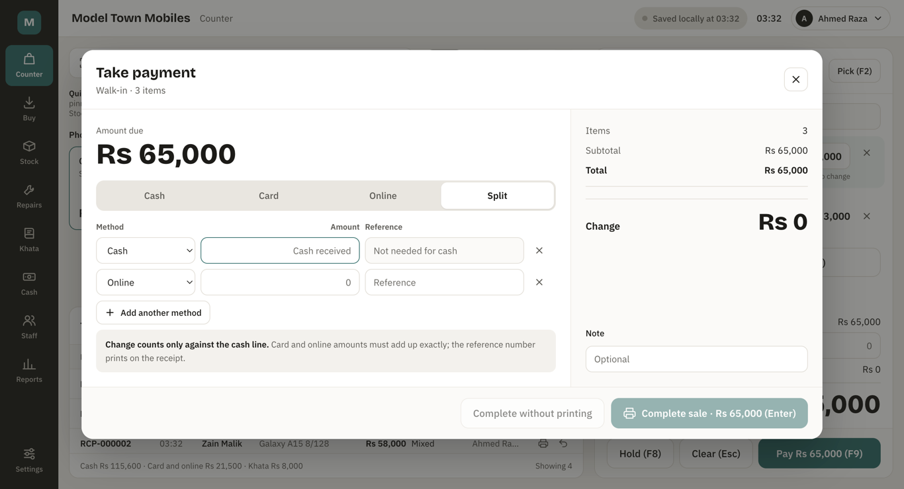

Whatever is not covered goes on the customer's khata and is shown in amber before you complete.
Card and online can never be more than the bill; only cash brings change.

**Complete sale** prints the receipt (or **Complete without printing**). The receipt shows each
phone's IMEI, PTA status and warranty end date, every payment line, what went on khata and the
customer's new balance. After the sale the cart becomes a success panel with the change to give
back, **Print again**, **Return this sale** and **New sale (Enter)**.

### Exchange: taking an old phone

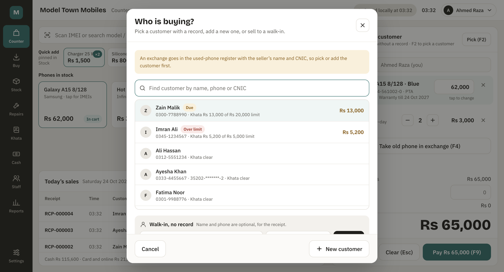

Pick the customer first (the used-phone register needs their name and CNIC), then **Take old
phone in exchange**. Fill in the old phone like a used-phone buy — model, IMEI, condition, PTA
status, the quick check — and the agreed value. The value comes off the bill; if it is more
than the bill, the shop pays the customer the difference and the receipt says "Paid to
customer". The old phone goes into stock as a trade-in at that value, and a buying slip prints
with the receipt.

### Returns

From **Today's sales** (the panel under the results) or the success panel, **Return** opens the
receipt's lines. Tick what is coming back, give a reason, choose **cash** or **to khata**, and
the admin types their PIN. Returns are allowed inside the return window (Settings › Sales rules,
7 days unless changed). A returned phone goes back into stock with its original cost;
accessories go back to their quantity.

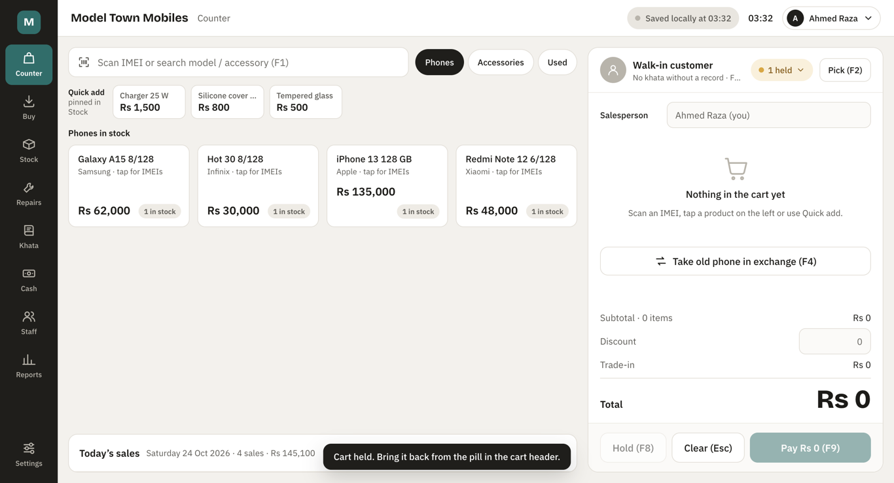

Keyboard: **F1** search, **F2** customer, **F4** exchange, **F8** hold, **F9** pay, **Esc**
clear or close, **Enter** completes a sale in the pay box and starts a new sale afterwards.

## 4. Buy: stock coming in

### From a supplier

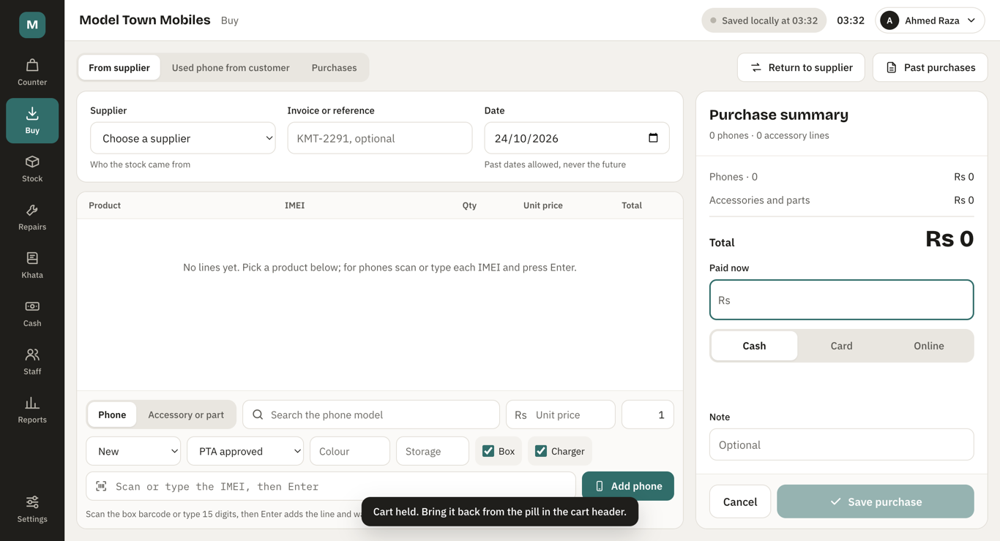

Pick the supplier (or add one on the spot), the invoice number and the date (past dates are
allowed, never the future). Add lines at the bottom:

- **Phone** — pick the model, type the unit price, set the condition, PTA status, colour,
  storage, box and charger once, then scan the IMEIs. **Qty** says how many of this model came
  in: set it to 5 and the box reads "Scan IMEI 1 of 5", each scan adds a line, and after the
  fifth the composer moves on to the next model. Every phone is one line with its own IMEI.
  An IMEI already in stock is refused and the message names the phone and when it arrived. A
  wrong check digit is flagged; only an admin can accept it as typed.
- **Accessory or part** — pick the item, the quantity and the unit price. The price becomes the
  item's last purchase price.

On the right, **Paid now** and the method; the rest goes on the supplier's khata (see
section 7). **Save purchase** writes everything at once.

**Return to supplier** (top right) takes phones or items out of stock and lowers what you owe
the supplier.

### A used phone from a customer

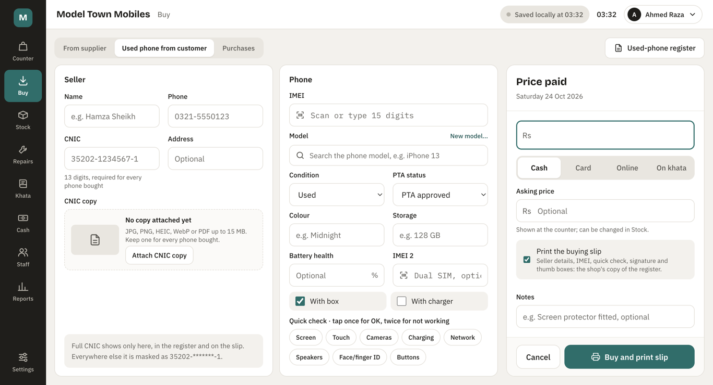

The seller's **name, phone and CNIC** are required — the CNIC is shown in full only here, in the
register and on the slip; everywhere else it is masked. If the CNIC is already on file, the app
offers to use that customer's record. **Attach CNIC copy** takes a photo or PDF of the card
(JPG, PNG, HEIC, WebP or PDF, up to 15 MB) and keeps it with the data file; it is never sent
anywhere.

Fill in the phone (pick a model or type a new one), the IMEI, condition, PTA status, battery
health, box and charger, and the **quick check** — tap each item once for OK, twice for not
working; it prints on the slip. Type the price paid and how it was paid (**On khata** means the
shop owes the seller — they become a customer with a credit balance). **Buy and print slip**
prints the buying slip with the seller's details, the IMEI, the quick check and signature and
thumb boxes. Keep the signed slip; it is the shop's used-phone register.

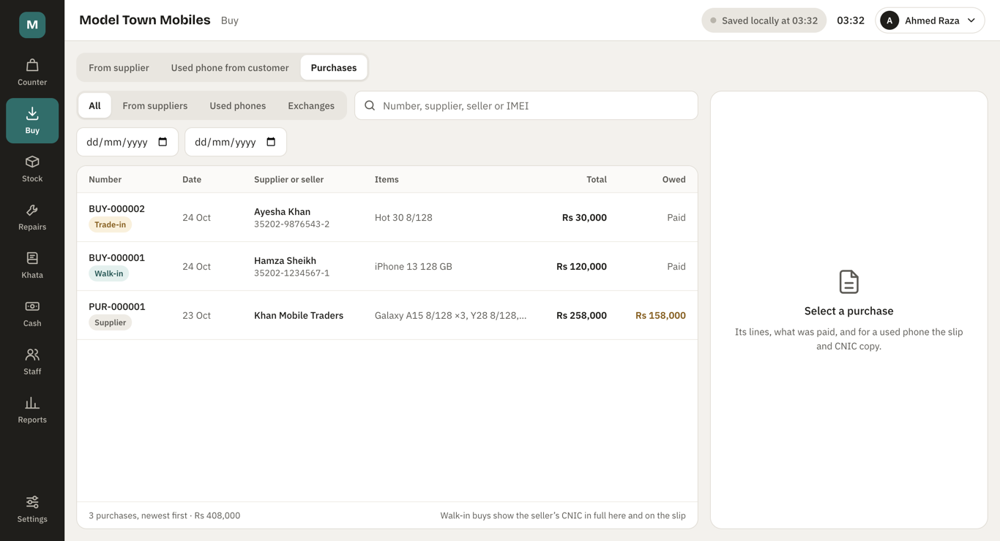

The **Purchases** tab lists every purchase; pick one to see its lines, reprint a slip, or
attach the CNIC copy later.

## 5. Stock

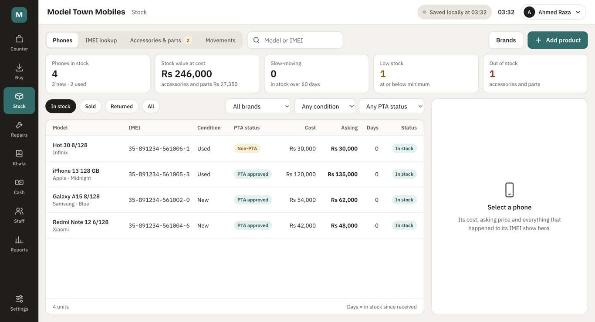

**Phones** are one row per IMEI with condition, PTA status, cost (admins only), asking price and
days in stock. Filter by in stock / sold / returned, brand, condition and PTA. Tap a row:

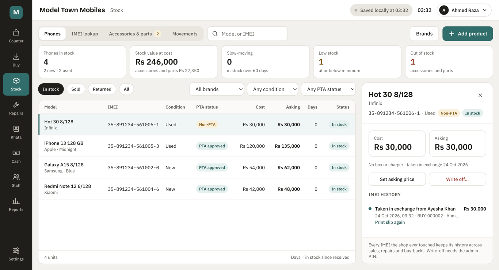

The card shows everything that ever happened to that IMEI — received, sold, returned, repaired,
bought back — with reprint links. Admins can **Set asking price** and **Write off** a lost or dead
phone (admin PIN; the cost is written off).

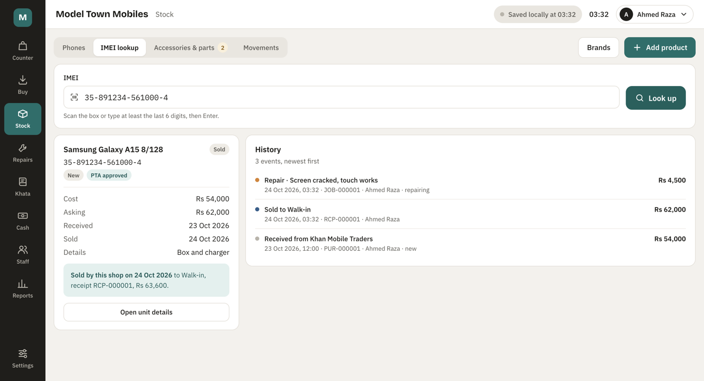

**IMEI lookup** takes the whole number or its last six digits, for a phone a customer brings back
or a police enquiry.

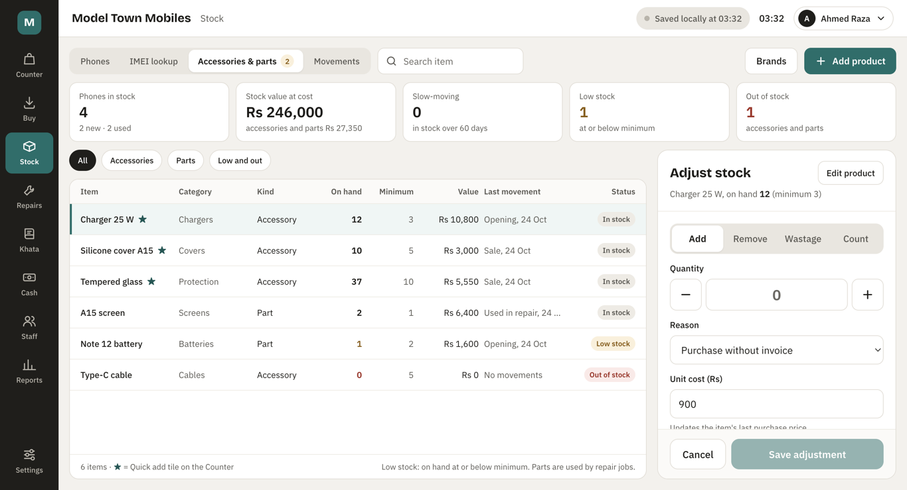

**Accessories & parts** are counted by quantity with a minimum; low and out-of-stock items are
badged and counted on the Stock cards. Pick an item to **Adjust** it (admins): add stock with a
price, remove, record wastage, or enter a counted quantity. **Add product** and **Brands** are
top right; a product can be a phone model, an accessory or a repair part, and accessories can be
**pinned** to the counter's Quick add row.

**Movements** lists every stock change with who made it and why.

## 6. Repairs

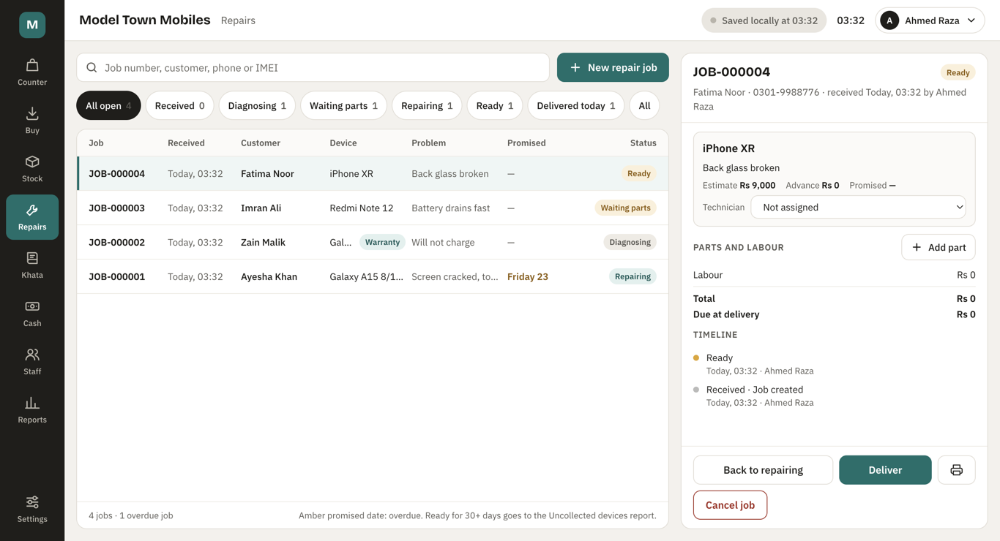

The table lists open jobs; the chips count them by status; an amber promised date means it has
passed. Pick a job to see its card on the right.

### Taking a device in

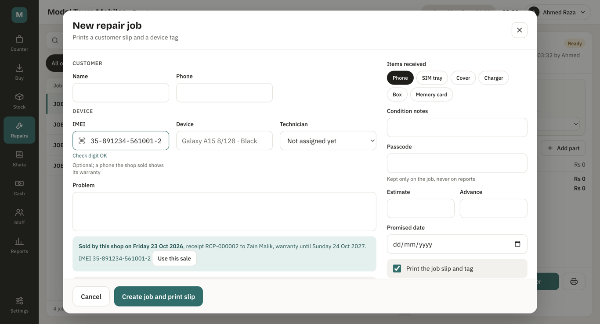

**New repair job** asks for the customer's name and phone (an existing customer is matched by
phone), the device, the IMEI (optional), the problem, what was received with it, condition
notes, a passcode if given (kept only on the job), an estimate, an advance and the promised date.

If the IMEI belongs to a phone **this shop sold** inside its warranty, the sale shows in a green
note and **Warranty claim** is ticked: labour and parts default to no charge, parts still leave
stock at cost, and the job slip says "Warranty claim, receipt RCP-…". A cashier can still enter a
charge for damage that is not covered.

**Create job and print slip** prints the customer's slip and a small tag that stays on the
device.

### Doing the work

The buttons under the card move the job: Received → Diagnosing → Waiting parts → Repairing →
Ready. Every move is written in the timeline with the time and the user. **Add part** takes a
part or accessory from stock at cost and puts its price on the job; a technician can do all of
this.

### Delivery, cancelling

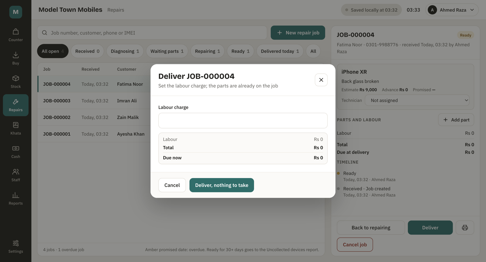

**Deliver** (admin or cashier, once the job is Ready) asks for the labour charge, shows parts +
labour − advance, then opens the same payment box as the counter; the rest can go on the
customer's khata. The repair bill prints with the repair warranty end date.

**Cancel job** records a job that was not repairable or that the customer cancelled: refund the
advance in full, or keep part of it as a checking fee; parts can go back to stock or stay
charged.

Jobs ready for longer than the Settings limit (30 days unless changed) appear in the
**Uncollected devices** report.

## 7. Khata: customers and suppliers

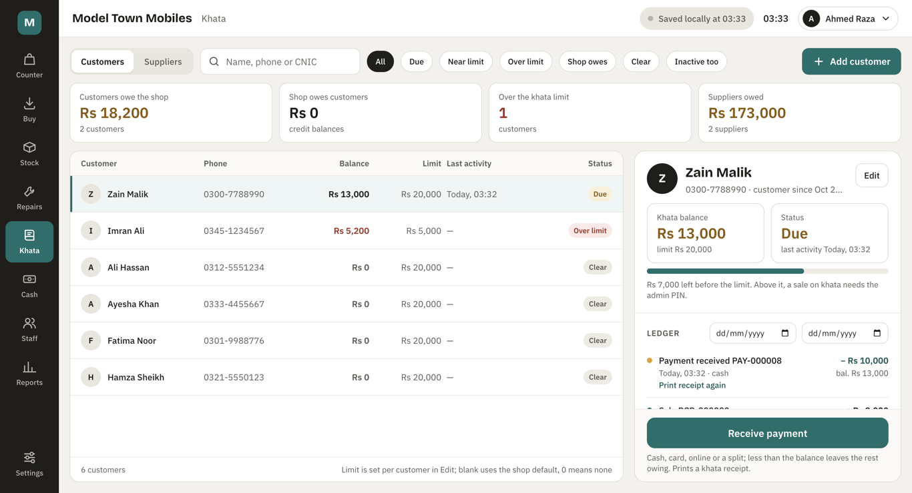

Every customer and supplier has a ledger: opening balance, sales or purchases, repair bills,
payments and refunds in date order with a running balance. The cards at the top show what
customers owe, what the shop owes customers (credit from khata buys), who is over the limit, and
what the shop owes suppliers.

Each customer has a **khata limit** (the shop default from Settings, or their own in **Edit**;
0 means no limit). A sale that would take them over asks for the admin PIN. Status badges:
Due, Near limit (90 % or more), Over limit, Shop owes, Clear.

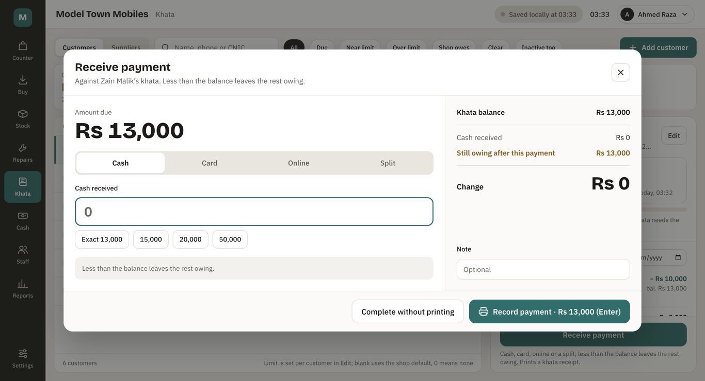

**Receive payment** takes cash, card, online or a split against the balance and prints a khata
receipt showing the balance before and after. On the **Suppliers** tab, **Pay supplier** records
what you pay them; the purchase's "paid now" and these payments together make the supplier's
balance.

## 8. Cash: expenses and closing the day

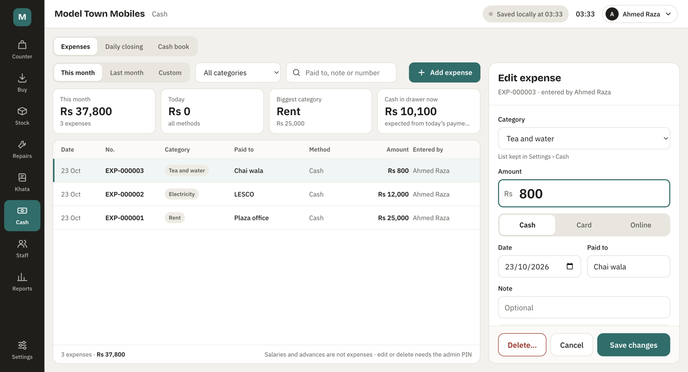

**Expenses** — category (list in Settings › Cash), amount, method, date (past allowed, not the
future), paid to, note. Each expense leaves the drawer like any other cash movement. Editing or
deleting one needs the admin PIN.

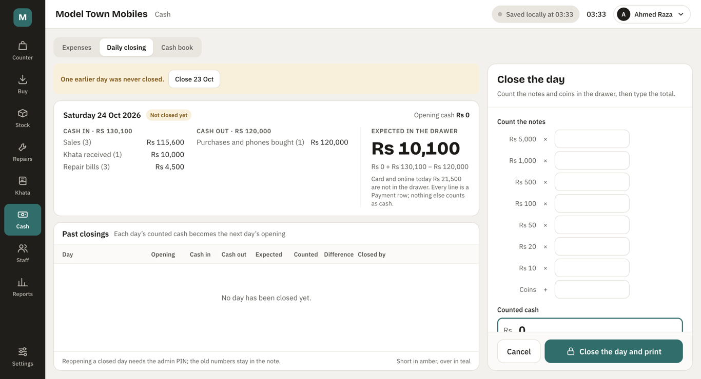

**Daily closing** — at the end of the day the screen shows the opening cash, cash in and out by
kind, and the **expected cash** in the drawer (only cash counts; card and online are listed
separately). Count the drawer with the note grid, check the total, and **Close the day**. A
difference must have a note; it shows amber when short, teal when over. The closing slip prints.

One closing per day; tomorrow opens with today's counted cash. An earlier day that was never
closed is flagged at the top. Reopening a closed day needs the admin PIN and keeps the old
numbers in the note. The **Cash book** tab lists every day; a payment entered after a day was
closed marks that day "changed after closing".

## 9. Staff and salaries

Admin only; nobody else can open this screen or see salaries.

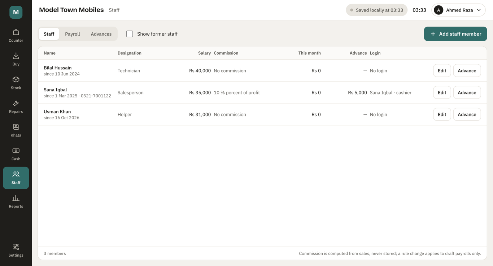

**Staff** — a record for everyone who gets paid, whether or not they have a login: designation,
joined date, monthly salary and the **commission rule** (percent of sale, percent of profit,
fixed amount per phone, or none; accessories optional). Linking a login to a staff record makes
their sales count for commission. **Advance** gives money against salary; it is recovered through
payroll.

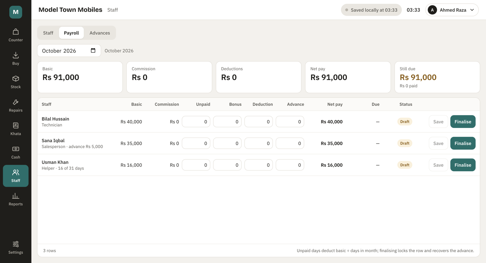

**Payroll** — pick the month and **Prepare payroll**: one draft row per member, basic pro-rated
for a joining or leaving month, commission computed from that month's sales less returns. Type
unpaid days (deducted at basic ÷ days in the month), bonus, other deduction and the advance to
recover, **Save**, then **Finalise** to lock the row. **Pay** writes the payment (in full or in
part) and prints the A4 salary slip; **Slip** previews it and can save a PDF.

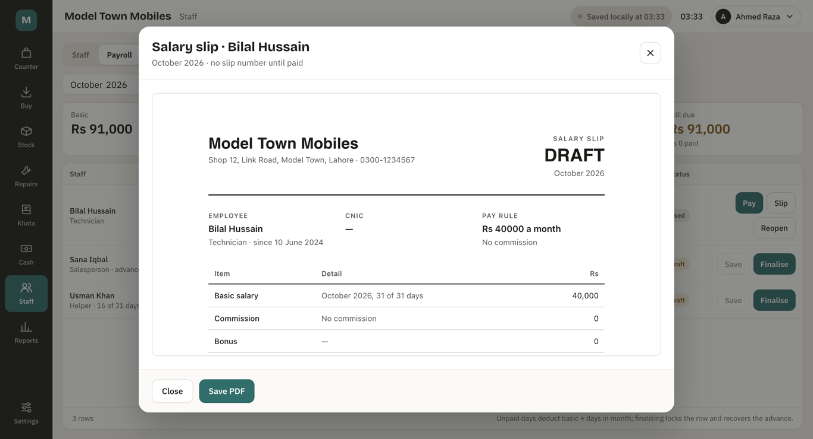

## 10. Reports

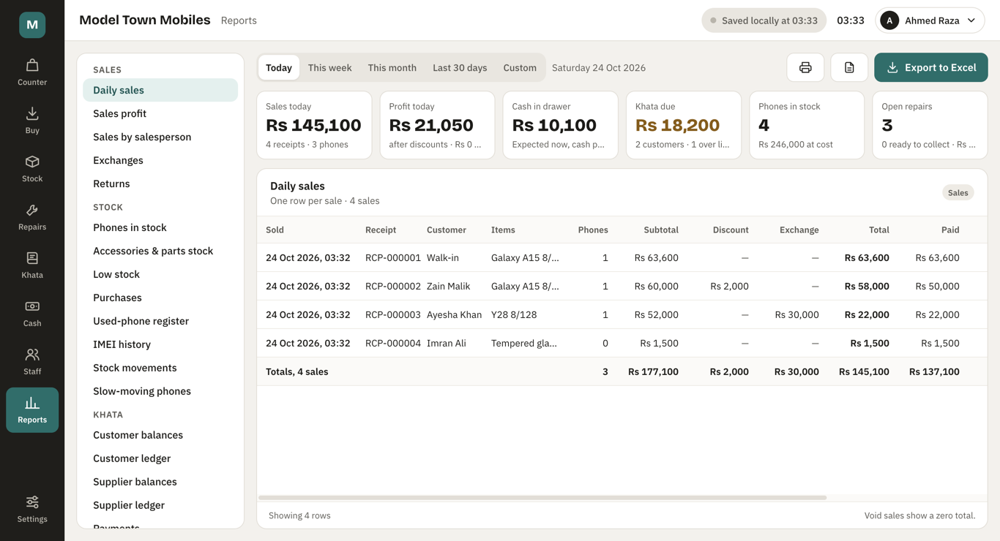

Thirty reports in seven groups — sales, stock, khata, repairs, cash, staff, summary — for today,
this week, this month, the last 30 days or any custom range. Ledger and commission reports ask
for the customer, supplier or staff member; IMEI history asks for the IMEI. Every report can be
**exported to Excel**, **printed** on A4 or **saved as PDF**. Reports that show cost, profit or
salaries are admins only; cashiers never see them; technicians see the repairs group.

The cards above the table are today at a glance: sales, profit (admin), cash in the drawer, khata
due, phones in stock and open repairs.

## 11. Settings

Admin only.

- **Shop details** — name, phone, address, currency.
- **Sales rules** — the cashier discount limit, the default khata limit, the return window, the
  warranty days for phones and accessories, the **PTA status list** shown on every phone and
  receipt, and whether split payments are allowed.
- **Cash** — expense categories and the opening cash for the very first day.
- **Receipt printer** — the thermal printer, print mode (Direct thermal for ESC/POS receipt
  printers, Via driver for others), paper width 58 or 80 mm, the footer text, auto-print, and the
  cash drawer that opens through the printer. **Test print** sends a sample receipt.

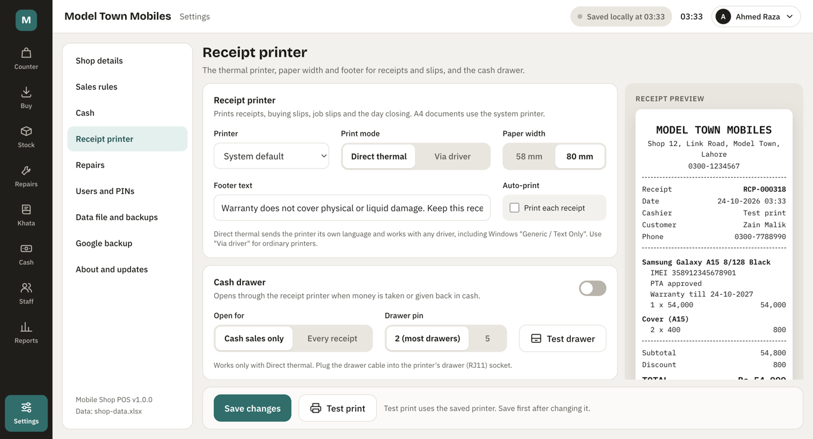

- **Repairs** — the uncollected-device limit and the default repair warranty.
- **Users and PINs** — add users, pick their role, reset a PIN, set the inactivity lock.

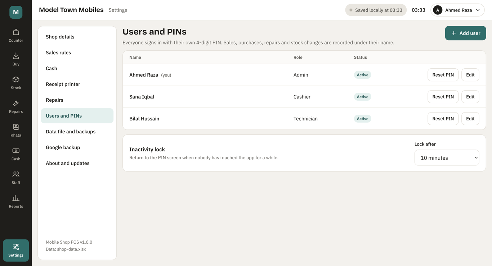

- **Data file and backups** — see the next section.
- **Google backup** — connect a Google account to mirror the data into a Google Sheet
  (read-only, CNICs masked, no PINs) and keep nightly copies of the workbook on Drive.
- **About and updates** — the version, and **Check for updates**; new versions download in the
  background and install on restart.

## 12. Your data and backups

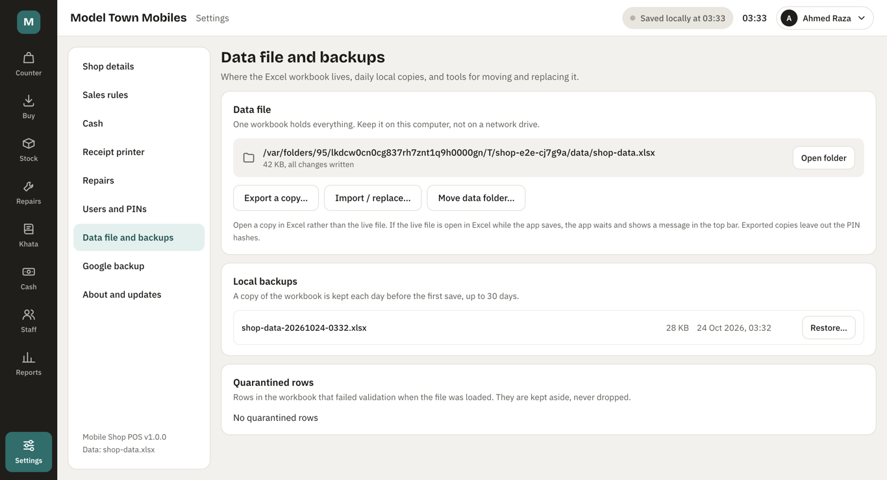

Everything lives in one Excel workbook, `shop-data.xlsx`, in the data folder, plus a folder of
CNIC copies next to it. Every sale, purchase, payment and repair is written to it straight away.

- **Local backups** — a copy of the workbook is kept each day before the first save (30 days).
  **Restore** puts one back (admin PIN).
- **Export a copy** — a copy for Excel with no PINs and masked CNICs. Open copies in Excel, not
  the live file: if the live file is open in Excel while the app saves, the app waits and shows a
  message in the top bar until Excel closes it.
- **Move data folder** — moves the workbook, the backups and the CNIC copies together.
- If the file was changed outside the app (edited in Excel, restored from a cloud copy), a
  banner offers **Reload** or **Keep mine**.
- The top bar's pill says when the last save happened ("Saved locally at 09:41") or that the
  file is busy.

## 13. A day in the shop, step by step

1. **Morning** — sign in. The drawer opens with yesterday's counted cash.
2. **Stock arrives** — Buy › From supplier: supplier, invoice, Qty per model, scan the IMEIs,
   accessories by quantity, paid now, save.
3. **Selling** — scan the IMEI or tap the model, add accessories, pick the customer if khata is
   involved, F9, take the money, print.
4. **A customer sells you a phone** — Buy › Used phone: name, phone, CNIC, CNIC photo, the phone,
   the quick check, the price; print the slip and have it signed.
5. **A repair comes in** — Repairs › New repair job; print the slip and tag. The technician moves
   it along and adds parts; a cashier delivers and takes the money.
6. **Someone pays their khata** — Khata › pick the customer › Receive payment › print the receipt.
7. **Expenses** — Cash › Expenses as they happen.
8. **Evening** — Cash › Daily closing: count the drawer, close the day, keep the slip.
9. **Any time** — Reports for the day, the month, or one customer or IMEI.

## 14. When something goes wrong

- **Nothing prints** — Settings › Receipt printer: is the right printer chosen and saved? Try
  **Test print**. Receipt printers that print garbage in Direct thermal mode usually want
  **Via driver**, and the other way round. A failed print never loses the sale; use **Print
  again**.
- **"The data file is open in another program"** — close the workbook in Excel; the app saves
  as soon as it is free.
- **A user is locked out** — five wrong PINs lock them for the minutes shown; wait, or an admin
  resets the PIN in Settings › Users.
- **Wrong sale** — return it (admin PIN) rather than editing anything in Excel.
- **Phone shows as already in stock** — the IMEI was received before; check IMEI lookup for when
  and where. If a phone was returned to a supplier, it was marked returned, not deleted.
- **The computer died** — install the app on the new one, put the data folder (workbook,
  backups, attachments) where you want it, and use Settings › Data file › Import / replace, or
  restore the latest copy from Google Drive.
- **Anything else** — Settings › About and updates › **Open logs** holds the technical log for
  support.

Support: Ibrar Ul Hassan · +92 344 3310252
